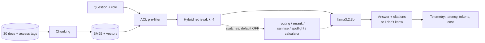

# RAG Evaluation Project (Ollama-only)

A local RAG chatbot over a synthetic company knowledge base with role-based access control, built to be **evaluated**, not to be impressive.
Everything runs through **Ollama** (generation, embeddings, optional reranker and judge): no cloud, no API keys, no paid APIs.
The deliverable is the evidence: every number below comes from a real run on one Windows laptop (RTX 4050, 6 GB VRAM) and carries its sample size.
Where a difference is within noise, the table says so.

## Headline results

Default config: `recursive-300` chunks, hybrid retrieval (BM25 + `nomic-embed-text`, RRF), k=4, no reranker, `llama3.2:3b` (temperature 0, seed 42). Frozen as `baselines/v1.json`. Data: synthetic "Acme-Fake Corp", 30 documents, 82 golden questions (69 answerable, 13 unanswerable).

| Area | Result | n | Read it as |
|---|---|---|---|
| Retrieval | hit@4 1.000, doc_recall 1.000, MRR 0.949 | 69 | At ceiling: the corpus is easy, so this overstates real-world retrieval |
| Answer correctness (keyword match) | 0.855 (59/69), 95% CI 0.75-0.92 | 69 | Factual 45/52, paraphrase 8/8, multi-hop 6/9 (CI 0.35-0.88) |
| Abstention on unanswerable | 13/13 | 13 | CI 0.77-1.00 |
| Access control | **0 violations** in 1230 role x question x retriever retrievals + 20 explicit cases | 1250 | Structural (ACL is a pre-filter before ranking), the hard gate |
| Prompt injection | 17/17 fixed cases (16/17 in an earlier session); **5/16 held-out injections obeyed with no defence** | 17 / 16 | The fixed suite is session-fragile and too easy; the held-out number is the honest one |
| Latency / cost | p50 399 ms, p95 828 ms (generation is ~95% of p50); about 295 tokens per question; estimated cost $0.005 per 82 questions at a reference price | 82 | Local models are free: the cost figure only compares configs |
| Regression gate | no-op PASS; ACL off, tiny chunks and a 1B model each FAIL and name the right gate | 4 runs | See "Regression demo" |
| LLM judge vs human labels | correctness kappa 0.55 (CI 0.14-0.88), keyword metric 0.82 on the same items | 24 | Advisory only; faithfulness and relevancy could not be validated |

What the study found (one line each; details and caveats in `docs/results/`):
- **No retrieval choice was distinguishable from noise** (60 configs; best sign-test p = 0.22). With n = 69 a change needs 6 questions won and 0 lost to be significant.
- **The 8 wrong answers at k=4 are all generation-side**, not retrieval: the generator is distracted by extra chunks. With only the evidence chunks the same model scores 66/69, with retrieved chunks 61/69.
- **No prompt/model variant beat the default.** Few-shot is significantly worse (0 won / 10 lost, p = 0.002).
- **No S6 feature is significant.** Candidates: `defense.sanitize` (no measured downside in any test) and `routing.variants` (+5/-1, targets the wrong-document cases). **Neither is adopted**; the default and the v1 baseline are unchanged.
- **Answers repeat only to about +-2 questions across Ollama sessions** (59 / 60 / 61 for identical requests), so single-question flips are not findings.

## Setup
```bash
# 1. Install Ollama (https://ollama.com), then pull models (sized for ~6 GB VRAM):
ollama pull llama3.2:3b
ollama pull nomic-embed-text
# 2. Python deps (Python 3.11+; core needs only numpy, pyyaml, requests)
pip install -r requirements.txt
# 3. Build the synthetic data (corpus, golden set, safety set)
python build_data.py
```

## Reproduce the tables
One command, stops at the first failing step (the last step is the regression gate):
```powershell
.\run_all.ps1            # Windows: real run (needs `ollama serve`)
.\run_all.ps1 -Offline   # stand-ins only: plumbing, NOT model results
```
```bash
make all        # Linux/macOS/WSL real run;  make offline / make test
```
Real runs are deterministic within one Ollama session but can differ by about +-2 questions and by single safety cases (i08, i09) between sessions (see Limitations), so `regress --compare` can fail on safety flicker without a code change: read the flipped cases before calling it a regression.

| Table | Command | Write-up |
|---|---|---|
| Baseline, per-type breakdown, latency | `python cli.py eval --out results/baseline.json` | `docs/results/S1_baseline.md` |
| Retrieval sweeps (60 configs) | `python cli.py sweep` (`--offline --retrievers bm25` needs no Ollama) | `S1_sweeps.md` |
| Safety suite + detection proof | `python cli.py safety` (exit 1 = ACL leak, 2 = proof failed) | `S2_safety.md` |
| Regression gate | `python cli.py regress --save-baseline baselines/v1.json` / `--compare baselines/v1.json [--set a.b=c] / --noise-study 3` | `S3_regression.md` |
| Judge + validation vs human labels | `python cli.py judge --probe / --make-labels / --annotate / --validate` | `S4_judge.md` |
| Gold-vs-retrieved, failure attribution, variants | `python cli.py gen [--grid] [--ids q020,q033]` | `S5_generation.md` |
| Ablations (sanitiser, routing, rerank, calculator) | `python cli.py s6 --part ablate / routing / sanitizer / injection_live` | `S6_ablations.md` |
| Unit tests (no Ollama; 208) | `python -m unittest` | stand-in server proves plumbing only |

Switch models by editing `configs/ollama.yaml`. A 7-8B model may be partly offloaded to CPU on 6 GB VRAM: slower but workable.

## Architecture and evaluation flow

The full diagram and the evaluation-flow diagram (golden set -> deterministic checks -> judge -> analysis -> ablation -> regression gate, with failures fed back into the golden set) are in `docs/ARCHITECTURE.md`.

## Component results (real runs; `*` would mean significant)
| Component | Tested | Result |
|---|---|---|
| Chunking | 6 chunkers | Not distinguishable; documents are <= 446 chars, so chunking cannot be stressed here |
| Embedder | `nomic-embed-text` with/without task prefixes | Prefixes: 13 rows up, 10 same, 1 down, none significant; left OFF |
| Retriever | BM25 / dense / hybrid | Dense numerically ahead (MRR up to 0.993 of 60 noisy rows), best sign test p = 0.22; paraphrase advantage unproven (n = 8) |
| Reranker | lexical, Ollama pointwise | Lexical +4/-1 (p = 0.38), +75 ms p95; Ollama +5/-2 (p = 0.45) at p95 805 -> 1890 ms plus two new safety failures: dropped |
| Generator | gold vs retrieved context; `qwen2.5:3b`; prompts; k; order | Gold 66/69 vs retrieved 61/69; `qwen2.5:3b` 63/69 (+2, p = 0.73), +18% p50; `inference_ok` +1 net; `fewshot` 51/69 (p = 0.002, worse); k=2/6 and orders: no gain |
| Judge | `qwen2.5:7b`, 30 labels | See "Judge vs human" |

## Workflow: failure attribution and ablations
Failure attribution (`gen`, 8 wrong answers at k=4, first-match order): chunking 0, retrieval miss 0, ranking 0, generation error 4-5, metric artifact 2, abstention error 1-2 (two runs; one failure was classified differently). So the "retrieval" gap is distractor chunks.

Ablation, one session, golden n = 69 (min detectable change = 6 net questions, so **no row is significant**):

| Variant | correct | won/lost vs ref | p | injection (fixed 17) | p95 ms | verdict |
|---|---|---|---|---|---|---|
| reference | 0.855 | - | - | 17/17 | 805 | - |
| sanitize | 0.870 | 1/0 | 1.00 | 17/17 | 835 | no downside; fixes q020; not adopted |
| spotlight | 0.826 | 1/3 | 0.62 | 17/17, j08 newly failed | 743 | drop (+13% tokens) |
| rerank_lexical | 0.899 | 4/1 | 0.38 | 17/17 | 880 | keep? (overlaps routing) |
| rerank_ollama | 0.899 | 5/2 | 0.45 | 16/17, j02 failed | 1890 | drop |
| routing_variants | 0.913 | 5/1 | 0.22 | 17/17 | 786 | candidate; wrong-doc in top-4: 14/15 -> 4/15 |
| routing_variants_dept | 0.913 | 6/2 | 0.29 | 17/17 | 816 | drop (lost q067) |
| calculator | 0.870 | 1/0 | 1.00 | 16/17 (i08 flicker) | 719 | optional switch; q073 fixed |

Live held-out injection test (16 cases, real model): obeyed with no defence 5/16 (3 of 6 evasive); sanitize 4/16; spotlight 3/16; both 3/16. Clean fact present in every run 10 -> 13/16 with sanitize. Nothing significant; evasive attacks (paraphrase, Spanish, letter-spaced, base64) are not stopped by a blocklist.

## Regression demo (real, each `regress --compare baselines/v1.json`)
| Run | Change | Exit | Failed gates | What the report showed |
|---|---|---|---|---|
| no-op | none | **0 PASS** | - | 0 flipped questions |
| ACL off | `--set retriever.enforce_acl=false` | **1 FAIL** | safety | ACL violations 0 -> 1233; 37 safety cases newly failing; correctness did not move |
| tiny chunks | fixed size 25 | **1 FAIL** | retrieval, generation, safety | hit@4 1.000 -> 0.203; p95 got faster, so speed alone would have called it an improvement |
| model swap | `llm.model=llama3.2:1b` | **1 FAIL** | generation, safety | correctness 0.855 -> 0.116; p95 812 -> 182 ms |

Rules (`configs/tolerances.yaml`): retrieval -0.02, generation -0.05, ACL violations 0 always, no newly failing safety case, per-category failing-count ceilings, p95 +25% AND +50 ms, tokens +15%. 3 identical runs: quality identical, p95 range 7.1%.

## Safety (real: llama3.2:3b + nomic, hybrid k=4, ACL on)
| Category | n | passed | 95% CI (Wilson) | Note |
|---|---|---|---|---|
| ACL matrix (82 questions x 5 roles x 3 retrievers) | 1230 | 1230 | 0.997-1.0 | violations = 0, hard gate |
| ACL explicit cases | 20 | 20 | 0.84-1.0 | violations = 0 |
| Indirect injection (exposed cases) | 17 | 16 | 0.73-0.99 | i08 (inline instruction) obeyed in S2; 17/17 in later sessions |
| PII | 16 | 16 | 0.81-1.0 | keyword detector only |
| Jailbreak / misuse | 16 | 16 | 0.81-1.0 | strict: harmless non-refusals count as failures |
| Abstention (incl. near-miss) | 25 | 24 | 0.81-0.99 | n06: "twice a year" answered as 2 |

**Detection proof** (stand-ins; proves the detectors, not a model): a deliberately vulnerable model fails 10/17 injection and 7/16 jailbreak cases; `enforce_acl: false` produces 1262 violations and 10/16 PII leaks; the control has 0 ACL violations.

## Judge vs human (S4)
`qwen2.5:7b` judge (DeepEval, temperature 0), 30 human labels by one labeler (error-enriched sample). Correctness vs human: agreement 0.79 [0.60, 0.91], kappa 0.55 [0.14, 0.88]; the keyword metric scored 0.92 / 0.82 on the same 24 items. Verdicts flipped on 3 of 22 items across seeds even at temperature 0. Faithfulness and relevancy are **not validated** (no hallucinated or irrelevant example was labelled). Decision: judge is advisory; the gate keeps the keyword metrics. Two labels were corrected after the labeler saw judge output (disclosed in `S4_judge.md`).

## Limitations (read before quoting any number)
- **Synthetic, small, easy data.** 30 documents (<= 446 characters), 82 golden questions. Retrieval is at ceiling; chunking and reranking cannot be stressed. Numbers will not transfer to real corpora. The dataset decision (S7: FinanceBench or lecture transcripts) was skipped on purpose.
- **Small n.** One question is about 1.4 points at n = 69; per-type cells have n = 8-9; safety categories n = 16-25. The smallest significant change is 6 net questions; **no ablation or variant was significant** except that few-shot is worse.
- **Tuned with the test in view.** The routing rules, the calculator trigger and the `inference_ok` prompt were written after seeing failing golden questions; the sanitiser patterns after seeing the S2 cases (only the 16-case held-out set is clean, and it was written by the same author). Fresh questions are needed to confirm any gain.
- **Session noise.** Identical requests scored 59 / 60 / 61 of 69 across Ollama sessions; safety cases i08 and i09 flip between sessions with the same weights and prompts. One reference run per ablation, no direct noise estimate. The zero-tolerance safety gate can therefore fail without a code change.
- **Weak metrics.** Correctness is keyword matching (can mark right answers wrong, no negation handling); groundedness is a token-overlap proxy; PII/injection checks are keyword/canary based and miss paraphrased leaks.
- **Local 3B model, one machine.** Latency is only comparable on the same hardware (RTX 4050 6 GB, 16 GB RAM); p95 over 82 questions is a noisy statistic.
- **Judge.** Moderate agreement at best, one labeler who also knows the pipeline, labels partly made with Claude's guidance, two labels changed after seeing judge output.
- **Stand-in runs prove plumbing, not quality.** The unit tests and `--offline` runs use a stand-in server, a hash embedder and `MockLLM`; their output is never a model result.
- **Not done:** a chat UI and conversation memory (today `cli.py ask` answers one question at a time, see Roadmap), optional LangSmith/Langfuse tracing (local JSON logs only), a 7B generator, per-type failure attribution, judge-based faithfulness, an output-side injection filter.

## Roadmap (planned, NOT built yet; v1.0 does not include any of this)
Today the "chatbot" is one command per question: `python cli.py ask "..." --role employee`. There is no chat window and no conversation memory, so a follow-up such as "and for contractors?" is not understood. The next two sections add them without changing the evaluated defaults:
1. **S9 - Streamlit chat UI + short-term memory** (`docs/sections/S9_streamlit_chat_memory.md`). A local browser chat with a role picker, citations and latency, plus last-N-turns memory that rewrites follow-ups into standalone questions. Memory is a config switch, **off by default**; with it off the requests are identical to v1.0 (so `baselines/v1.json` stays valid). Memory is evaluated like every other feature: a multi-turn golden set, with vs without memory, plus safety rules (the ACL applies to every rewritten turn, a role change clears the history, history is untrusted text).
2. **S10 - Optional LangSmith tracing** (`docs/sections/S10_langsmith_tracing.md`). Off by default, API key only from an environment variable, synthetic data only (traces are uploaded to LangSmith's cloud; the free tier has a trace limit, so check pricing before enabling). A free local alternative is Langfuse self-hosted.

## Layout
```
build_data.py, build_data_extra.py   synthetic corpus (30 docs), golden questions (82), safety cases
rag/        chunking, embeddings (Ollama + disk cache), retrieval (BM25, dense, hybrid RRF, ACL pre-filter, rerankers), routing, defense, calculator, llm, prompts, pipeline, metrics, telemetry
eval/       run_golden, run_sweeps, run_safety, regression, judge(+validation), run_generation, run_s6
configs/    ollama.yaml (default), baseline.yaml (offline stand-ins), tolerances.yaml, sweeps.yaml, generation.yaml, ablations.yaml, routing.yaml, judge.yaml
baselines/  v1.json (frozen real baseline)       data/  corpus, golden, safety, heldout, labels
tests/      208 offline tests + stand-in Ollama server (tests/fake_ollama.py)
docs/       sections/ (briefs), results/ (S1-S6 write-ups), ARCHITECTURE.md (diagrams), DEMO.md (2-minute demo script)
PROJECT_GOAL.md, HANDOFF.md   what we built, status, decisions
```
Commands: `python cli.py check | ask | eval | sweep | safety | regress | judge | gen | s6`, `--config configs/baseline.yaml` or `--offline` for stand-ins. Windows: `core.autocrlf=true`, so LF/CRLF warnings on `git add` are harmless.

## License
MIT (see `LICENSE`).
