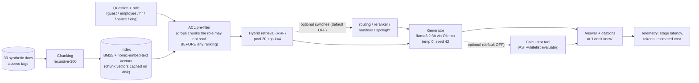
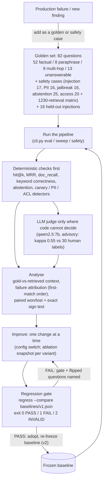

# Architecture and evaluation flow

Mermaid diagrams (rendered by GitHub). Both describe what the code in this repo does; nothing here is aspirational.

## 1. Application architecture (what is being evaluated)

## 2. Evaluation flow (the course workflow: golden set -> criteria -> method -> run -> analyse -> improve -> re-run)

Detection proof (safety suite): the same suite is also run against a deliberately vulnerable stand-in model and with the ACL switched off; the detectors must fire. That proves the tests can fail, which a clean pass alone cannot.
